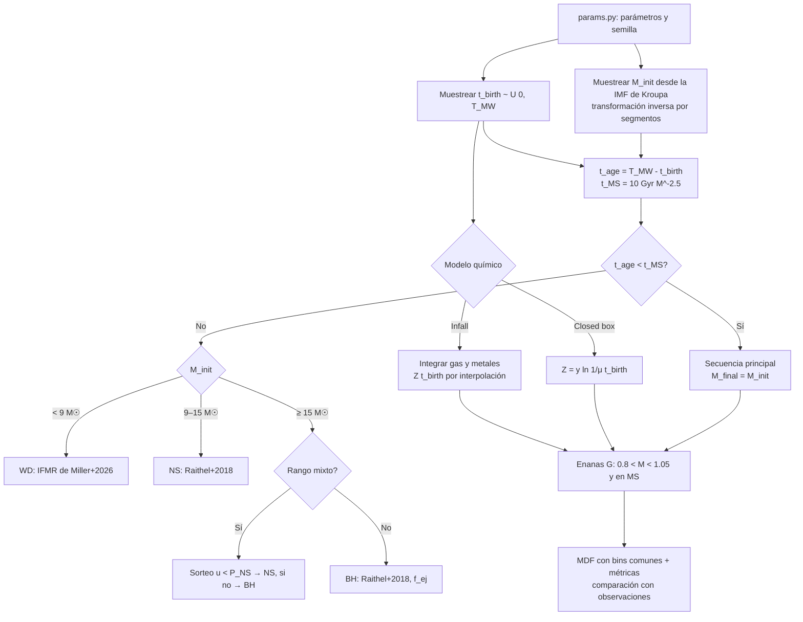

Síntesis de población estelar one-zone con evolución química (closed box e infall) y comparación con la MDF de enanas G del vecindario solar (G-dwarf problem). Curso AST-305 Astrofísica Computacional II, USM.

## Diagrama de flujo
 

